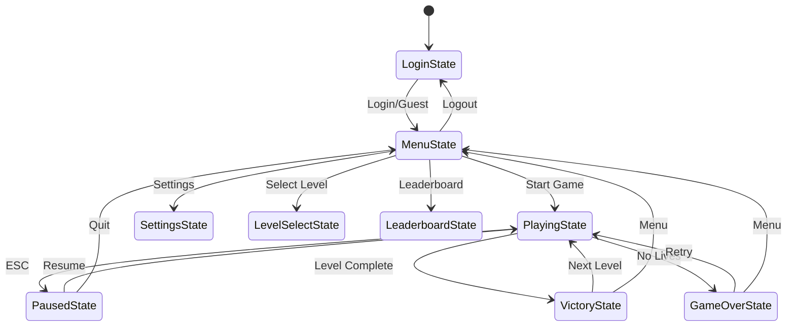
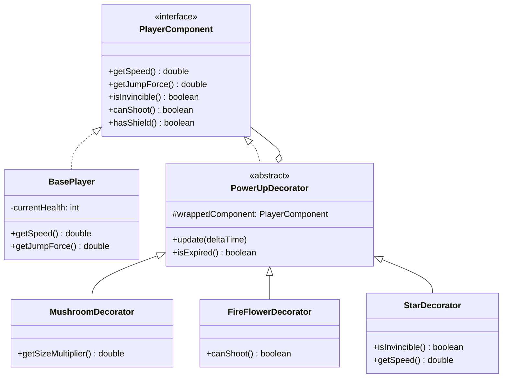
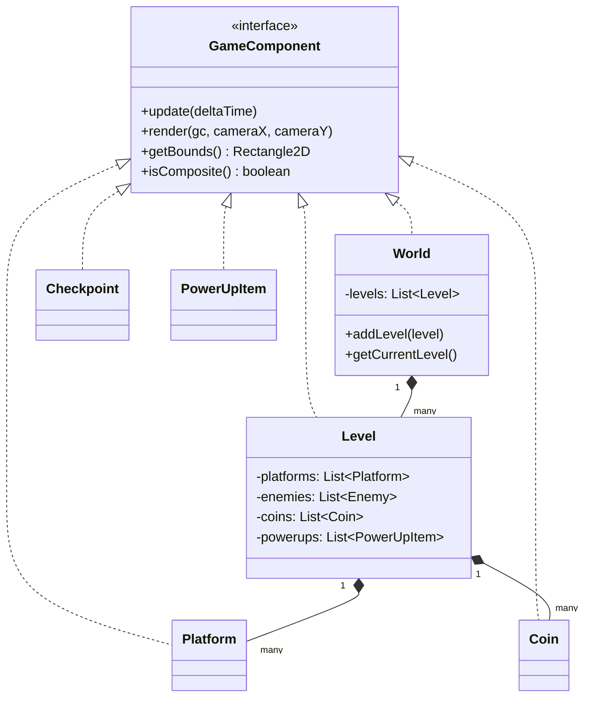
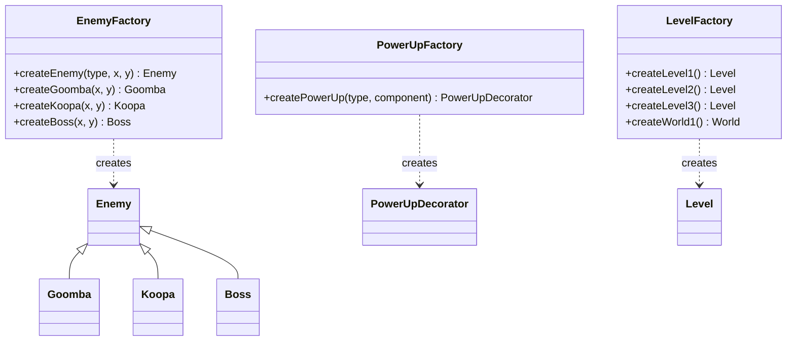
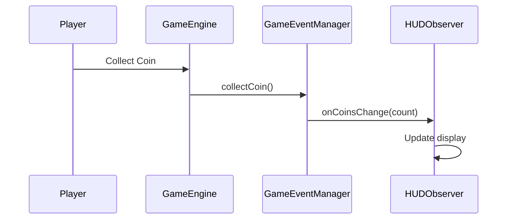

# Super Mario Game - Full Project Report

## 📋 Executive Summary

This project is a **fully-functional 2D platformer game** inspired by Super Mario, developed in **Java with JavaFX**. The game demonstrates **5 major Design Patterns** with clean architecture, making it suitable for academic evaluation and learning purposes.

| Aspect | Details |
|--------|---------|
| **Language** | Java 17+ |
| **Framework** | JavaFX 21 |
| **Build Tool** | Maven |
| **Lines of Code** | ~4,500+ |
| **Number of Classes** | 35+ |
| **Design Patterns** | 5 (State, Decorator, Composite, Factory, Observer) |

---

## 🎮 Game Features

### Complete User Journey
```
Login → Menu → Level Select → Play → Victory/Game Over → Leaderboard → Logout
```

### Gameplay Features
- **3 Progressive Levels**: Grassland → Underground → Castle (Boss Fight)
- **5 Power-ups**: Mushroom, Fire Flower, Star, Speed Boost, Shield
- **3 Enemy Types**: Goomba, Koopa (with shell), Boss
- **Collectibles**: Coins, Checkpoints
- **Physics**: Gravity, Jumping, Collision Detection

### System Features
- **User Authentication**: Login, Register, Guest Mode
- **Persistent Data**: Users saved to JSON, Leaderboard saved
- **Fullscreen Mode**: Toggle with F11
- **Mouse Support**: Click all buttons

---

## 🧩 Design Patterns Implementation

### 1️⃣ State Pattern
**Purpose**: Manage game states and transitions cleanly.



**Key Classes**:
- `GameState.java` - Interface defining state behavior
- `GameStateManager.java` - Context managing transitions
- 9 Concrete States: Login, Menu, Playing, Paused, GameOver, Victory, Settings, LevelSelect, Leaderboard

---

### 2️⃣ Decorator Pattern
**Purpose**: Add abilities to player dynamically without modifying base class.



**Power-ups Stack**:
```java
player.applyPowerUp(new MushroomDecorator(...));  // +size, +health
player.applyPowerUp(new FireFlowerDecorator(...)); // +shooting
// Player now has BOTH abilities!
```

---

### 3️⃣ Composite Pattern
**Purpose**: Hierarchical structure for game levels.



---

### 4️⃣ Factory Pattern
**Purpose**: Centralized object creation for enemies, power-ups, and levels.



---

### 5️⃣ Observer Pattern
**Purpose**: Decouple HUD updates from game events.



**Key Classes**:
- `GameObserver.java` - Interface with event methods
- `GameEventManager.java` - Subject managing observers
- `HUDObserver.java` - Concrete observer updating display

---

## 📁 Project Structure

```
SuperMario/
├── pom.xml                          # Maven configuration
├── README.md                        # Quick start guide
├── FullReport.md                    # This document
├── data/
│   ├── users.json                   # User accounts
│   └── leaderboard.json             # High scores
└── src/main/
    ├── java/com/mario/
    │   ├── Main.java                # Application entry
    │   ├── auth/
    │   │   ├── AuthenticationService.java
    │   │   └── User.java
    │   ├── game/
    │   │   ├── GameEngine.java      # Main game loop
    │   │   ├── LeaderboardService.java
    │   │   ├── states/              # STATE PATTERN
    │   │   │   ├── GameState.java
    │   │   │   ├── GameStateManager.java
    │   │   │   ├── LoginState.java
    │   │   │   ├── MenuState.java
    │   │   │   ├── PlayingState.java
    │   │   │   ├── PausedState.java
    │   │   │   ├── GameOverState.java
    │   │   │   ├── VictoryState.java
    │   │   │   ├── SettingsState.java
    │   │   │   ├── LevelSelectState.java
    │   │   │   └── LeaderboardState.java
    │   │   ├── player/
    │   │   │   ├── PlayerComponent.java  # DECORATOR interface
    │   │   │   ├── BasePlayer.java
    │   │   │   └── Player.java
    │   │   ├── powerups/            # DECORATOR PATTERN
    │   │   │   ├── PowerUpDecorator.java
    │   │   │   ├── MushroomDecorator.java
    │   │   │   ├── FireFlowerDecorator.java
    │   │   │   ├── StarDecorator.java
    │   │   │   ├── SpeedBoostDecorator.java
    │   │   │   └── ShieldDecorator.java
    │   │   ├── enemies/
    │   │   │   ├── Enemy.java
    │   │   │   ├── Goomba.java
    │   │   │   ├── Koopa.java
    │   │   │   └── Boss.java
    │   │   ├── levels/              # COMPOSITE PATTERN
    │   │   │   ├── GameComponent.java
    │   │   │   ├── World.java
    │   │   │   ├── Level.java
    │   │   │   ├── Platform.java
    │   │   │   ├── Coin.java
    │   │   │   ├── Checkpoint.java
    │   │   │   └── PowerUpItem.java
    │   │   ├── factories/           # FACTORY PATTERN
    │   │   │   ├── EnemyFactory.java
    │   │   │   ├── PowerUpFactory.java
    │   │   │   └── LevelFactory.java
    │   │   └── observers/           # OBSERVER PATTERN
    │   │       ├── GameObserver.java
    │   │       ├── GameEventManager.java
    │   │       └── HUDObserver.java
    │   └── utils/
    │       ├── GameLogger.java
    │       └── SoundManager.java
    └── resources/
        └── log4j2.xml
```

---

## 🎯 SOLID Principles Applied

| Principle | Application |
|-----------|-------------|
| **S**ingle Responsibility | Each class has one job (e.g., `GameLogger` only logs) |
| **O**pen/Closed | Power-ups extend via `PowerUpDecorator` without modifying `BasePlayer` |
| **L**iskov Substitution | All `GameState` implementations are interchangeable |
| **I**nterface Segregation | `GameComponent` has minimal methods |
| **D**ependency Inversion | States depend on `GameStateManager` interface, not concrete classes |

---

## 🔧 How to Build and Run

### Prerequisites
- Java 17 or higher
- Maven 3.9+

### Commands
```bash
# Compile
mvn clean compile

# Run
mvn javafx:run

# Package JAR
mvn package
```

---

## 🎮 Controls

| Key | Action |
|-----|--------|
| ← / A | Move Left |
| → / D | Move Right |
| ↑ / W / Space | Jump |
| ESC / P | Pause |
| F11 | Toggle Fullscreen |
| Enter | Select |
| Tab | Switch Fields (Login) |
| Mouse | Click Buttons |

---

## 📊 Sample Log Output

```
[2025-12-14 20:00:00] [STATE] Game: LOGIN → MENU
[2025-12-14 20:00:05] [AUTH] Login successful: ahmed
[2025-12-14 20:00:10] [STATE] Game: MENU → PLAYING
[2025-12-14 20:00:10] [LEVEL] Started: World 1-1: Grassland
[2025-12-14 20:00:15] [DECORATOR] Mushroom applied to Player
[2025-12-14 20:00:20] [PLAYER] Enemy defeated: Goomba
[2025-12-14 20:00:25] [OBSERVER] Event: Coin collected - Data: 5
[2025-12-14 20:00:30] [STATE] Game: PLAYING → VICTORY
[2025-12-14 20:00:30] [AUTH] New high score: ahmed: 1500
```

---

## 📈 Academic Quality Checklist

- ✅ Clean code with meaningful names
- ✅ Proper package structure
- ✅ Design patterns clearly implemented
- ✅ SOLID principles followed
- ✅ Logging for demonstration
- ✅ User-friendly interface
- ✅ Persistent data storage
- ✅ Documentation provided

---

## 📜 License

This project is for **educational purposes only**.
No affiliation with Nintendo or the Super Mario franchise.

---

*Generated: December 14, 2025*
