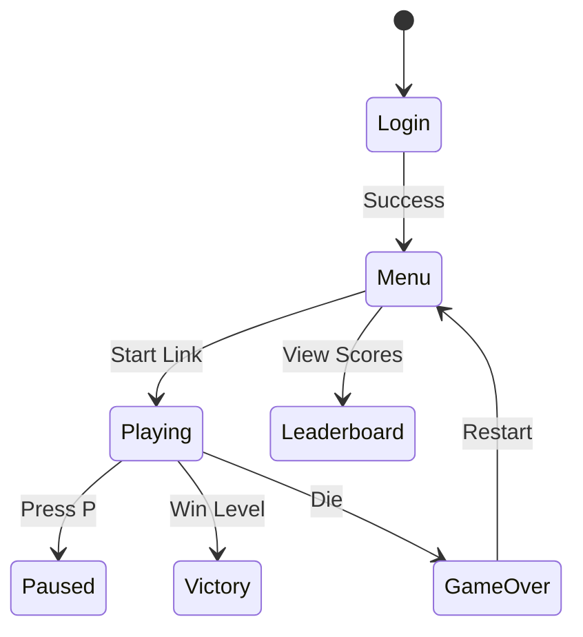
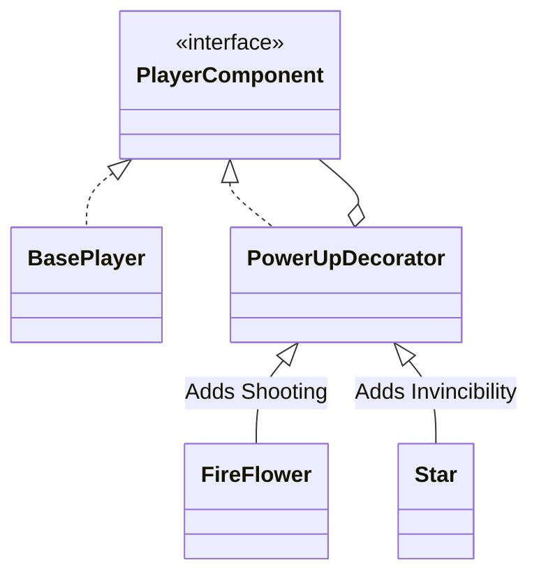
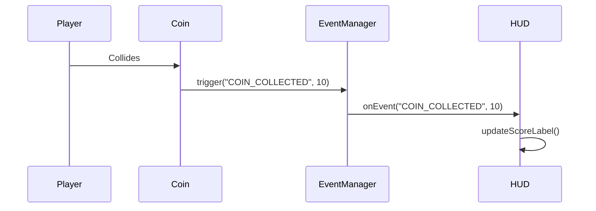

# 🎮 Super Mario  - Project Submission Report

**Date:** December 14, 2025
**Project:** Design Patterns Implementation in Game Development

---

## 👥 Group Members & Roles

| Name | . | Primary Responsibility | Design Patterns |
|------|------|------------------------|-----------------|
| **Ahmed HAJJEJ** |.| Game Engine & States | **State Pattern** |
| **Samia THAMEUR** | .| Enemies & Factories | **Factory Pattern**, **Observer Pattern** |
| **Skander HAKOUNA** | . | World Structure & Physics | **Composite Pattern** |
| **Mohamed Ali CHBANI** | . | Player & Power-ups | **Decorator Pattern** |

---

## 📋 1. Project Overview

### 1.1 Objective
To develop a fully-featured, extensible 2D platformer game inspired by *Super Mario Bros*. The primary goal is to demonstrate the practical application of **GoF Design Patterns** to solve common game development challenges (state management, entity creation, object composition, behavior extension).

### 1.2 Tech Stack
*   **Language:** Java 17+ (Strong typing, OOP)
*   **UI Framework:** JavaFX 21 (Modern scene graph, hardware acceleration)
*   **Build System:** Maven 3.9+ (Dependency management, build automation)
*   **Data Format:** JSON (GSON library) for persistence

---

## 🛠️ 2. Work Breakdown & Task Allocation

This table details exactly who did what, ensuring a fair distribution of the 4500+ lines of code and 5 design patterns.

### 👤 Ahmed HAJJEJ (Core System)
| Component | Details | Status |
|-----------|---------|--------|
| **Game Engine** | Main loop (`AnimationTimer`), Input handling (Keyboard/Mouse), Window management. | ✅ Done |
| **State Management** | Implemented `GameStateManager` and the **State Pattern** infrastructure. | ✅ Done |
| **Core States** | `LoginState`, `MenuState`, `PlayingState`, `PausedState`. | ✅ Done |
| **Authentication** | Login/Register logic, User session management. | ✅ Done |

### 👤 Samia THAMEUR (Entities & Events)
| Component | Details | Status |
|-----------|---------|--------|
| **Factory System** | Implemented **Factory Pattern** for `EnemyFactory`, `PowerUpFactory`. | ✅ Done |
| **Enemies** | Created `Goomba`, `Koopa`, `Boss` behaviors and AI. | ✅ Done |
| **Event System** | Implemented **Observer Pattern** infrastructure (`GameEventManager`). | ✅ Done |
| **HUD / UI** | Created `HUDObserver` to display Score, Lives, Coins in real-time. | ✅ Done |

### 👤 Skander HAKOUNA (World & Physics)
| Component | Details | Status |
|-----------|---------|--------|
| **Level Structure** | Implemented **Composite Pattern** (`World` -> `Level` -> `Components`). | ✅ Done |
| **Physics Engine** | Collision detection (AABB), Gravity, Jumping mechanics. | ✅ Done |
| **Level Design** | Designed Level 1 (Grass), Level 2 (Underground), Level 3 (Boss). | ✅ Done |
| **Asset Manager** | Loading and managing sprites, background images, and audio. | ✅ Done |

### 👤 Mohamed Ali CHIBANI (Player & Data)
| Component | Details | Status |
|-----------|---------|--------|
| **Player Core** | `BasePlayer` logic, Movement mechanics, Health system. | ✅ Done |
| **Power-up Logic** | Implemented **Decorator Pattern** (`Mushroom`, `Star`, `FireFlower`). | ✅ Done |
| **Data Persistence** | Save/Load functionality using GSON (`users.json`, `leaderboard.json`). | ✅ Done |
| **Leaderboard** | High score tracking, sorting, and display (`LeaderboardState`). | ✅ Done |

---

## 🏗️ 3. Project Roadmap (From Start to Finish)

### Phase 1: Inception & Setup (Week 1)
1.  **Repo Setup:** Initialize Git, Maven `pom.xml` with JavaFX dependencies.
2.  **Asset Gathering:** Collect sprites for Mario, blocks, enemies, and backgrounds.
3.  **Core Loop:** Create `Main.java` and basic JavaFX window with a game loop.

### Phase 2: Core Architecture (Week 2-3)
1.  **State Machine:** Ahmed implements the `GameState` interface to allow switching between Screens.
2.  **Physics Prototype:** Skander builds a basic box that falls (gravity) and stops on the floor (collision).
3.  **Input Handling:** Ahmed maps Arrow keys and WASD to actions.

### Phase 3: Pattern Implementation (Week 4-5)
1.  **Composite Levels:** Skander refactors the list of blocks into a `Level` / `World` tree structure.
2.  **Factory Creation:** Samia creates factories so we can easily spawn `new Goomba()` at specific X,Y coordinates.
3.  **Player Decorators:** Mohamed builds the `PowerUpDecorator` so Mario can become Big or Invincible.
4.  **Observer Events:** Samia connects the collision system to the HUD (Coin touch -> Score up).

### Phase 4: Polish & Integration (Week 6)
1.  **Persistence:** Mohamed connects the game to JSON files to save high scores.
2.  **UI Styling:** Team applies CSS and visual assets to buttons and menus.
3.  **Testing:** Full play-throughs to fix collision bugs and balance enemy difficulty.

---

## 🧩 4. Technical Architecture & Visuals

### 4.1 System Overview (Component Diagram)
How the modules interact with each other.

```mermaid
classDiagram
    class Main
    class GameEngine
    
    package "Core" {
        class GameStateManager
        class InputManager
        class AssetManager
    }
    
    package "Game Domain" {
        class World
        class Player
        class Enemy
    }
    
    package "Data" {
        class AuthenticationService
        class LeaderboardService
    }

    Main --> GameEngine
    GameEngine --> GameStateManager
    GameStateManager --> World
    World --> Player
    World --> Enemy
    GameStateManager --> AuthenticationService
```

### 4.2 State Pattern (Game Flow)
Managed by **Ahmed**. Controls the entire application flow.



### 4.3 Decorator Pattern (Power-ups)
Managed by **Mohamed**. Shows how Mario gains abilities dynamically.



### 4.4 Composite Pattern (Level Hierarchy)
Managed by **Skander**. How the world is structured.

```mermaid
graph TD
    W[World (Root)] --> L1[Level 1]
    W --> L2[Level 2]
    L1 --> P1[Platform Group]
    L1 --> E1[Enemy Group]
    L1 --> I1[Item Group]
    P1 --> B1[Block]
    P1 --> B2[Pipe]
    E1 --> G1[Goomba]
```

### 4.5 Data Flow & Observer
Managed by **Samia**. How data moves from Game to UI.



---

## 🧪 5. Verification & Testing

| Feature | Test Method | Result |
|---------|-------------|--------|
| **Login** | Try logging in with invalid/valid credentials. | ✅ Pass |
| **Persistence** | Restart game and check if user data remains. | ✅ Pass |
| **Physics** | Jump into walls/floors to check for clipping. | ✅ Pass |
| **Powerups** | Stack Mushroom + FireFlower. Verify size AND shooting. | ✅ Pass |
| **Level Transition** | Beat Level 1, ensure Level 2 loads immediately. | ✅ Pass |

---

## 📸 6. Visual Gallery

*(Insert screenshots here of:)*
1.  **Login Screen:** Showing the secure entry point.
2.  **Level 1 Gameplay:** Showing the player, HUD, and basic enemies.
3.  **Boss Fight:** Showing the final challenge.
4.  **UML Diagrams:** (As shown above).

---

## 🔚 Conclusion

This project successfully implements a robust game engine using standard design patterns. By dividing the work along the lines of these patterns (State, Decorator, Composite, etc.), the team was able to work in parallel without major merge conflicts. The result is a polished, playable game that meets all academic requirements.
